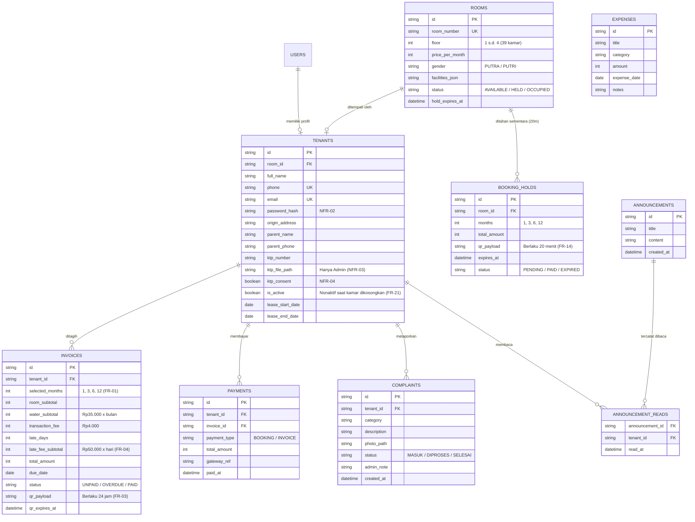
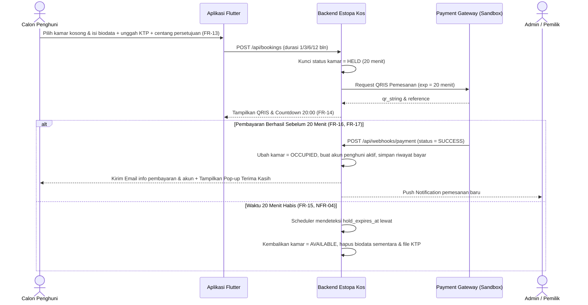
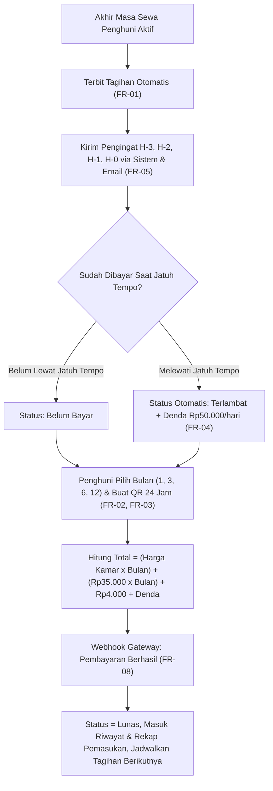

# Dokumen Perancangan Teknis (Sprint 2 & Kontrak API): Estopa Kos

Dokumen ini melengkapi [PRD.md](file:///c:/contohaplikasi/cntohaplikasi/docs/PRD.md) dan [PROJECT_PLAN.md](file:///c:/contohaplikasi/cntohaplikasi/docs/PROJECT_PLAN.md) dengan diagram UML, ERD database, dan kontrak endpoint API untuk tim pengembang D-4 TRPL Politeknik Negeri Medan.

---

## 1. Entity-Relationship Diagram (ERD)

---

## 2. Alur Pemesanan Kamar & QR 20 Menit (`FR-12` s.d. `FR-17`)

---

## 3. Alur Tagihan Otomatis, Denda & QR 24 Jam (`FR-01` s.d. `FR-08`)

---

## 4. Kontrak Endpoint REST API per Pembagian Tim

### A. Modul Pemesanan & Pembayaran (PIC Usulan: Andrew)
- `GET /api/rooms` — Daftar 39 kamar (filter `floor`, `gender`, `status`) tanpa autentikasi (`FR-12`).
- `POST /api/bookings` — Buat pemesanan baru, unggah KTP (`multipart/form-data`), tahan kamar 20 menit, kembalikan QRIS 20 menit (`FR-13`, `FR-14`).
- `POST /api/webhooks/payment-gateway` — Terima callback status bayar pemesanan maupun tagihan (`FR-08`, `FR-16`).

### B. Modul Tagihan, Keuangan & Scheduler (PIC Usulan: Henri)
- `GET /api/invoices` — Daftar tagihan penghuni (atau daftar belum bayar/terlambat untuk Admin `FR-06`, `FR-07`).
- `POST /api/invoices/{id}/qr` — Pilih jumlah bulan (`1, 3, 6, 12`) dan terbitkan QR tagihan masa berlaku 24 jam beserta kalkulasi denda terbaru (`FR-02`, `FR-03`, `FR-04`).
- `GET /api/finance/summary` — Rekap pemasukan otomatis, pengeluaran, dan saldo bersih (`FR-09`, `FR-10`).
- `POST /api/finance/expenses` — Catat pengeluaran kos oleh Admin (`FR-11`).

### C. Modul Kamar, Penghuni, Keluhan & Pengumuman (PIC Usulan: Sutanto)
- `POST /api/auth/login` — Login dengan email atau nomor HP + password (`FR-29`), tolak jika `is_active == false` (`FR-21`).
- `GET /api/admin/tenants` & `POST /api/admin/tenants` & `PUT /api/admin/tenants/{id}` — Kelola data penghuni & KTP (`FR-18`, `FR-19`).
- `POST /api/admin/tenants/{id}/reset-password` — Reset kata sandi penghuni oleh Admin (`FR-22`).
- `POST /api/admin/rooms/{id}/vacate` — Kosongkan kamar & nonaktifkan akun penghuni sebelumnya (`FR-21`).
- `GET /api/complaints` & `POST /api/complaints` & `PATCH /api/complaints/{id}/status` — Lapor dan ubah status keluhan (`FR-23` s.d. `FR-25`).
- `GET /api/announcements` & `POST /api/announcements` & `POST /api/announcements/{id}/read` — Pengumuman dan pencatatan status sudah dibaca (`FR-26` s.d. `FR-28`).
